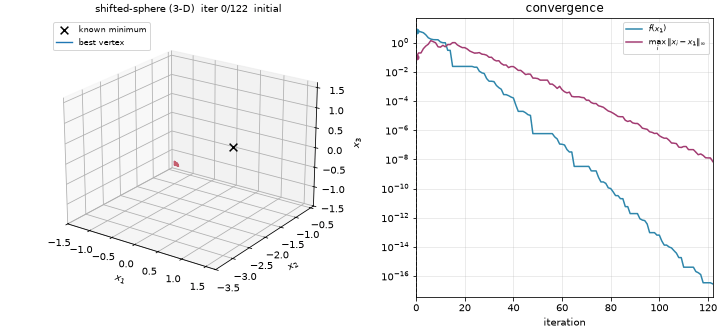

# Optimization Methods

Numerical optimization from first principles. The repository holds two projects:

* a derivative-free Nelder-Mead simplex solver that matches SciPy's iteration and
  evaluation counts exactly (final iterates agree to 1e-14);
* a constrained engineering-design optimizer (penalty + barrier SUMT with Steepest Descent,
  Newton and DFP) behind a small web UI.

[](https://github.com/gcfialho/uerj-optimization-methods/actions/workflows/ci.yml)

[](https://docs.astral.sh/uv/)
[](https://docs.astral.sh/ruff/)
[](LICENSE)


*Coursework from the Optimization course of the Computer Engineering program at UERJ (Rio de Janeiro State University),
rewritten as a tested, typed, packaged Python project.*

## Projects

| Project | What it is | What it demonstrates |
| --- | --- | --- |
| [`nelder-mead/`](nelder-mead/) | N-dimensional Nelder-Mead with benchmark functions, CSV histories and 2-D/3-D animations; `nelder-mead` CLI | Implementing a numerical algorithm from its paper definition and validating it against a reference implementation (identical evaluation counts and iterates); vectorized NumPy; property-style tests of the simplex invariants |
| [`tank-optimizer/`](tank-optimizer/) | Minimum-cost cylindrical tank under volume and size constraints; Flask + Plotly UI and a `tank-optimizer` CLI | Modeling a constrained problem, exterior-penalty / interior-barrier sequences, Newton and quasi-Newton line-search methods with exact derivatives, numerical-precision debugging |

## The math

### Nelder-Mead

For $f:\mathbb{R}^n\to\mathbb{R}$, keep $n+1$ vertices sorted by $f$, with centroid
$\bar{x}$ of the best $n$. Each iteration replaces the worst vertex $x_{n+1}$ by the first
acceptable point among

$$
x_r = \bar{x} + \alpha(\bar{x} - x_{n+1}),\quad
x_e = \bar{x} + \gamma(x_r - \bar{x}),\quad
x_{oc} = \bar{x} + \rho(x_r - \bar{x}),\quad
x_{ic} = \bar{x} + \rho(x_{n+1} - \bar{x}),
$$

or else shrinks every vertex towards the best: $x_i \leftarrow x_1 + \sigma(x_i - x_1)$.
The coefficients are $\alpha = 1,\ \gamma = 2,\ \rho = 0.5,\ \sigma = 0.5$, with acceptance
rules as in Lagarias et al. (1998). The run stops when
$\max_i\lVert x_i - x_1\rVert_\infty \le 10^{-8}$ and $\max_i |f_i - f_1| \le 10^{-8}$.
The [project README](nelder-mead/README.md) has the full table.

### Tank design

$$
\begin{aligned}
\min_{D,\,L}\quad & C(D,L) = c_m\,\rho\,\Big[\pi L\big((\tfrac{D}{2}+t)^2-(\tfrac{D}{2})^2\big) + 2\pi(\tfrac{D}{2}+t)^2\,t\Big] + 4\pi c_w\,(D+t)\\
\text{s.t.}\quad & 0.9\,V_0 \le \tfrac{\pi}{4} D^2 L \le 1.1\,V_0,\qquad L \le 2\ \text{m},\qquad D \le 1\ \text{m}
\end{aligned}
$$

The data are $V_0 = 0.8\ \text{m}^3$, $t = 0.03$ m, $\rho = 8000\ \text{kg/m}^3$,
$c_m = 4.5$ \$/kg and $c_w = 20$ \$/m. The solver first applies an exterior penalty
$C + r\sum\max(0, g_i + \delta)^2$ until the design is strictly feasible, then minimizes
the log barrier $C - \mu\sum\ln(-g_i)$ for $\mu = 10 \to 0.01$. Each subproblem is solved
by SD, Newton or DFP with exact derivatives.

## Results

All numbers come from the commands in this README (Python 3.12, NumPy 2.5, SciPy 1.18).

**Nelder-Mead** (`uv run nelder-mead --all --compare-scipy`), same initial simplex and
tolerances for both solvers:

| Problem | Iterations | f evals | Final f | Distance to x* | SciPy nfev | Max. difference from SciPy x |
| --- | ---: | ---: | ---: | ---: | ---: | ---: |
| Rosenbrock 2-D | 126 | 232 | 9.7e-18 | 1.7e-9 | 232 | 1.4e-14 |
| Booth 2-D | 66 | 130 | 5.9e-17 | 6.1e-9 | 130 | 8.9e-16 |
| Himmelblau 2-D | 66 | 129 | 1.9e-16 | 3.8e-9 | 129 | 4.4e-16 |
| Sphere 3-D | 126 | 235 | 2.2e-17 | 4.7e-9 | 235 | 1.3e-14 |
| Shifted sphere 3-D | 122 | 228 | 2.9e-17 | 5.4e-9 | 228 | 4.0e-15 |

**Tank** (`uv run tank-optimizer compare`), starting from the infeasible design $(0.5, 0.5)$.
The reference optimum lies on the minimum-volume boundary: $D^* = 0.948760$ m,
$L^* = 1.018428$ m, $C^* = 5354.35$ \$.

| Method | D* [m] | L* [m] | Cost [\$] | Gap to C* | Iterations | f evals | Status |
| --- | ---: | ---: | ---: | ---: | ---: | ---: | --- |
| Newton | 0.9487 | 1.0185 | 5,354.36 | 0.01 \$ | 45 | 146 | converged |
| DFP | 0.9487 | 1.0185 | 5,354.36 | 0.01 \$ | 96 | 337 | converged |
| Steepest Descent | 0.9837 | 0.9474 | 5,361.21 | 6.86 \$ | 200 | 4,810 | feasible, budget spent |

<p>
  
  
</p>

## Quickstart

Requires [uv](https://docs.astral.sh/uv/). It installs Python 3.12 and every dependency.

```bash
git clone https://github.com/gcfialho/uerj-optimization-methods.git
cd uerj-optimization-methods
uv sync

uv run nelder-mead --function rosenbrock --dim 2 --animate    # -> output/rosenbrock-2d.{csv,gif}
uv run nelder-mead --function sphere --dim 6 --compare-scipy
uv run tank-optimizer                                         # UI at http://127.0.0.1:5050
uv run tank-optimizer compare --d0 0.32 --l0 1.98
```

To regenerate the committed CSV histories and GIFs:

```bash
uv run nelder-mead --all --animate --output-dir nelder-mead/results --gif-dir docs/assets
```

## Repository layout

```
.
├── pyproject.toml            # uv workspace root: members, dev tools, ruff + pytest config
├── uv.lock
├── nelder-mead/              # package `nelder_mead` (src layout) + tests + results/*.csv
├── tank-optimizer/           # package `tank_optimizer` (src layout, Flask templates/static) + tests
├── docs/assets/              # README animations
└── .github/workflows/ci.yml  # ruff check, ruff format --check, pytest on 3.12 and 3.13
```

The repository is a uv workspace with two independent packages. Each one has its own
dependencies and console script, and they share a single lockfile and dev toolchain.

## Testing

```bash
uv run pytest                 # 86 tests
uv run ruff check . && uv run ruff format --check .
```

The test suite covers:

* convergence to the known minimizers;
* step-by-step equivalence with SciPy, including a case that triggers a shrink;
* simplex invariants: sorted vertices, monotone best value, and the volume ratio of every
  operation ($\alpha$, $\alpha\gamma$, $\alpha\rho$, $\rho$, $\sigma^n$);
* hand-computed tank costs;
* exact derivatives against finite differences;
* the constrained optimum from several starts, the DFP inverse-Hessian staying positive
  definite, and the Flask API (including input validation).

## Author

**Guilherme Fialho**, Machine Learning Engineer (GenAI / LLMs) and Data Engineer (Python).
[GitHub](https://github.com/gcfialho) · [LinkedIn](https://www.linkedin.com/in/guilherme-cagide-fialho/)

Released under the [MIT License](LICENSE).
