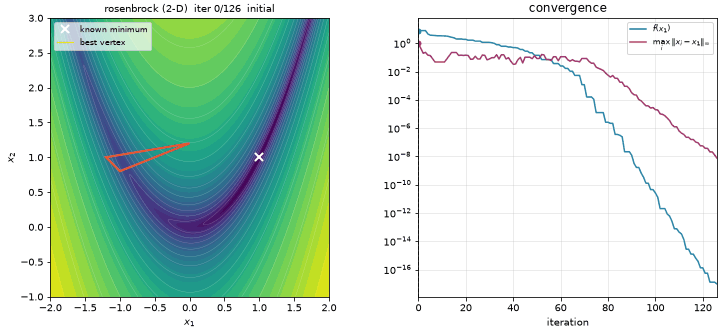
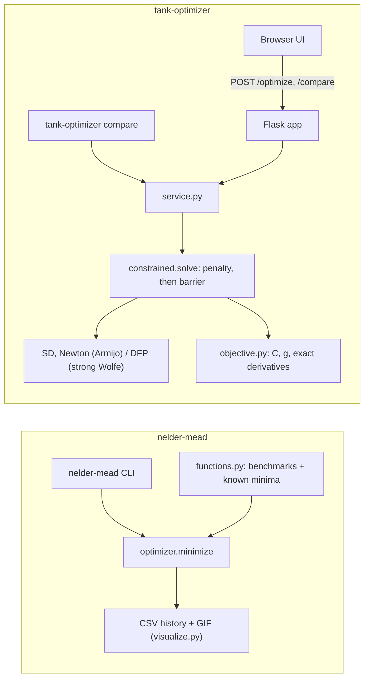
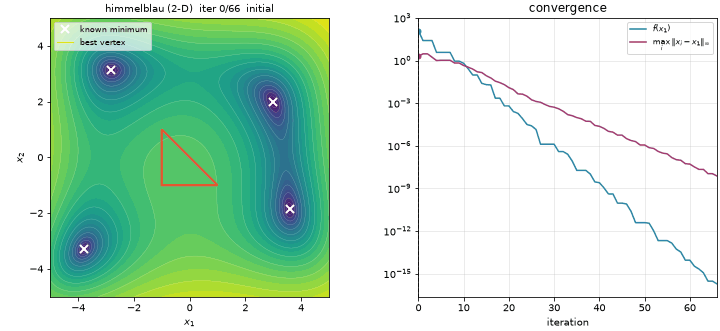

# Optimization Methods

A Nelder-Mead simplex solver that matches SciPy step for step, and a constrained tank-design optimizer (penalty + barrier with Steepest Descent, Newton and DFP) behind a small web UI.

[](https://github.com/gcfialho/uerj-optimization-methods/actions/workflows/ci.yml)  [](LICENSE)



## Highlights

- **Algorithm from its definition, checked against a reference.** Nelder-Mead in the formulation of Lagarias et al. (1998). On every bundled problem it needs the same number of iterations and function evaluations as `scipy.optimize.minimize(method="Nelder-Mead")`, and the final points agree to 1e-14.
- **Invariants as tests.** Every iteration keeps the vertices sorted, the best value never increases, and each operation scales the simplex volume by its theoretical factor ($\alpha$, $\alpha\gamma$, $\alpha\rho$, $\rho$, $\sigma^n$). All five branches, shrink included, are exercised.
- **Constrained optimization done carefully.** The tank problem is solved with an exterior penalty until the design is feasible, then a log barrier with a decreasing weight. Gradients and Hessians are exact, checked against finite differences. Newton reaches the optimum, to within \$0.01, from every start tested.
- **Debugging numerical failures.** The original version reported infeasible designs as optimal: near $f \approx 10^{12}$, finite differences return a gradient of exactly zero. That root cause is documented and fixed (see [tank-optimizer](tank-optimizer/README.md#changes-from-the-original-coursework-version)).
- **Packaged and reproducible.** uv workspace, src layouts, typed code, two CLIs, ruff, 88 pytest tests, and GitHub Actions on Python 3.12 and 3.13.

## Quickstart

Requires [uv](https://docs.astral.sh/uv/), which installs Python 3.12 and all dependencies from `uv.lock`.

```bash
git clone https://github.com/gcfialho/uerj-optimization-methods.git
cd uerj-optimization-methods
uv sync

# Nelder-Mead
uv run nelder-mead --function rosenbrock --dim 2 --animate   # writes output/rosenbrock-2d.csv and .gif
uv run nelder-mead --function sphere --dim 6 --compare-scipy
uv run nelder-mead --all --compare-scipy                     # every bundled demo

# Tank optimizer
uv run tank-optimizer                                        # web UI at http://127.0.0.1:5050
uv run tank-optimizer compare --d0 0.5 --l0 0.5              # SD vs Newton vs DFP in the terminal
```

## How it works

| Project | What it does | Entry point |
| --- | --- | --- |
| [`nelder-mead/`](nelder-mead/) | Derivative-free minimization in any dimension. Bundled benchmarks: Rosenbrock, Booth, Himmelblau, sphere and shifted sphere. Writes per-iteration CSV histories and 2-D/3-D simplex animations. | `nelder-mead` CLI, `nelder_mead.minimize()` |
| [`tank-optimizer/`](tank-optimizer/) | Minimum-cost cylindrical steel tank under volume and size constraints. Solved by penalty and barrier subproblems, each minimized with Steepest Descent, Newton or DFP. | `tank-optimizer` (Flask + Plotly UI) and `tank-optimizer compare` |



## Results

Measured with the commands above on Python 3.12, NumPy 2.5 and SciPy 1.18.

**Nelder-Mead** (`uv run nelder-mead --all --compare-scipy`). Both solvers use the same initial simplex and `xatol = fatol = 1e-8`:

| Problem | Iterations | f evals | f(x*) | Error to known optimum | SciPy f evals | Max. difference from SciPy x |
| --- | ---: | ---: | ---: | ---: | ---: | ---: |
| Rosenbrock 2-D | 126 | 232 | 9.7e-18 | 1.7e-9 | 232 | 1.4e-14 |
| Booth 2-D | 66 | 130 | 5.9e-17 | 6.1e-9 | 130 | 8.9e-16 |
| Himmelblau 2-D | 66 | 129 | 1.9e-16 | 3.8e-9 (to (3, 2)) | 129 | 4.4e-16 |
| Sphere 3-D | 126 | 235 | 2.2e-17 | 4.7e-9 | 235 | 1.3e-14 |
| Shifted sphere 3-D | 122 | 228 | 2.9e-17 | 5.4e-9 | 228 | 4.0e-15 |

SciPy reports one more iteration (127, 67, …) because its counter starts at 1. With the same simplex, the original coursework version used 399 evaluations on Rosenbrock and stopped at f = 8.3e-7, 2.0e-3 from the optimum.

**Tank** (`uv run tank-optimizer compare --d0 0.5 --l0 0.5`). The start is infeasible. The reference optimum lies on the minimum-volume boundary: $D^* = 0.948760$ m, $L^* = 1.018428$ m, $C^* = 5354.35$ \$.

| Method | D [m] | L [m] | Cost [\$] | Gap to C* | Iterations | f evals | Status |
| --- | ---: | ---: | ---: | ---: | ---: | ---: | --- |
| Newton | 0.9487 | 1.0185 | 5,354.36 | 0.01 \$ | 45 | 146 | converged |
| DFP | 0.9487 | 1.0185 | 5,354.36 | 0.01 \$ | 41 | 432 | stopped at float precision of f |
| Steepest Descent | 0.9837 | 0.9474 | 5,361.21 | 6.86 \$ | 200 | 4,810 | feasible, budget spent |

Across eight starts (the default plus the seven distinct UI presets):

- **Newton** converges every time, in 44 to 64 iterations.
- **DFP** always ends within \$0.01 of $C^*$, in 41 to 50 iterations. It meets the gradient tolerance from 2 of the 8 starts; from the others it stops because the line search can no longer resolve a decrease in f (see Limitations).
- **Steepest Descent** always ends feasible, between \$1.3 and \$336 above $C^*$.

<p>
  
  
</p>

## Methodology

### Nelder-Mead

Keep $n+1$ vertices sorted by value, $f(x_1) \le \dots \le f(x_{n+1})$, and let $\bar{x}$ be the centroid of the best $n$. Each iteration tries

$$
x_r = \bar{x} + \alpha(\bar{x} - x_{n+1}),\quad
x_e = \bar{x} + \gamma(x_r - \bar{x}),\quad
x_{oc} = \bar{x} + \rho(x_r - \bar{x}),\quad
x_{ic} = \bar{x} + \rho(x_{n+1} - \bar{x})
$$

and keeps the first one that is accepted:

1. **Reflection** $x_r$, if $f_1 \le f_r < f_n$.
2. **Expansion** $x_e$, if $f_r < f_1$ and $f_e < f_r$. Otherwise keep $x_r$.
3. **Outside contraction** $x_{oc}$, if $f_n \le f_r < f_{n+1}$ and $f_{oc} \le f_r$.
4. **Inside contraction** $x_{ic}$, if $f_r \ge f_{n+1}$ and $f_{ic} < f_{n+1}$.
5. **Shrink** otherwise: $x_i \leftarrow x_1 + \sigma(x_i - x_1)$.

The coefficients are $\alpha = 1$, $\gamma = 2$, $\rho = 0.5$ and $\sigma = 0.5$. The run terminates when both tests hold:

- $\max_i \lVert x_i - x_1 \rVert_\infty \le$ `xatol`;
- $\max_i |f_i - f_1| \le$ `fatol`.

Both tolerances default to $10^{-8}$. Each budget, iterations and evaluations, is $200n$.

### Tank design

Decision variables are the inner diameter $D$ and the length $L$, in metres. The data are:

- plate thickness $t = 0.03$ m;
- steel density $\rho_s = 8000\ \text{kg/m}^3$;
- material cost $c_m = 4.5$ \$/kg and weld cost $c_w = 20$ \$/m;
- required volume $V_0 = 0.8\ \text{m}^3$.

The cost is the steel of the shell and two end plates, plus two weld seams per end plate at the mean diameter:

$$
\begin{aligned}
\min_{D,\,L}\quad & C(D,L) = c_m\,\rho_s\Big[\pi L\big((\tfrac{D}{2}+t)^2-(\tfrac{D}{2})^2\big) + 2\pi(\tfrac{D}{2}+t)^2\,t\Big] + 4\pi\,c_w\,(D+t)\\
\text{s.t.}\quad & g_1 = 0.9\,V_0 - \tfrac{\pi}{4}D^2L \le 0,\qquad g_2 = \tfrac{\pi}{4}D^2L - 1.1\,V_0 \le 0,\\
& g_3 = L - 2 \le 0,\qquad g_4 = D - 1 \le 0.
\end{aligned}
$$

The problem is solved as a sequence of unconstrained subproblems (SUMT), each warm-started from the previous solution and minimized by the selected method. SD and Newton use Armijo backtracking; DFP uses a strong-Wolfe line search ($c_1 = 10^{-4}$, $c_2 = 0.1$):

1. **Exterior penalty**, only while the design is infeasible: $\psi_r = C + r\sum_i \max(0,\ g_i + 10^{-3})^2$ for $r = 10^5, 10^6, \dots$, until the design is strictly feasible.
2. **Interior barrier**: $\phi_\mu = C - \mu \sum_i \ln(-g_i)$ for $\mu = 10, 1, 0.1, 0.01$.

The final subproblem must satisfy $\lVert\nabla\phi_\mu\rVert \le$ `tol` (default $10^{-6}$).

## Project structure

```
.
├── pyproject.toml              # uv workspace root: members, dev tools, ruff + pytest config
├── uv.lock
├── nelder-mead/
│   ├── src/nelder_mead/        # optimizer, functions, visualize, cli
│   ├── results/                # CSV histories of the bundled demos
│   └── tests/
├── tank-optimizer/
│   ├── src/tank_optimizer/     # objective, constrained, optimizers, service, app, cli, templates, static
│   └── tests/
├── docs/img/                   # README animations
└── .github/workflows/ci.yml
```

## Testing

```bash
uv run pytest                                        # 88 tests
uv run ruff check . && uv run ruff format --check .
```

The tests cover:

- **Nelder-Mead:**
  - convergence to the known minimizers;
  - equality with SciPy's iteration count, evaluation count and final point, including a case that starts with a shrink;
  - the simplex invariants listed above;
  - budget limits and input validation;
  - the CLI's CSV and GIF output.
- **Tank:**
  - hand-computed cost values;
  - exact derivatives against finite differences;
  - the constrained optimum from six starting points per method;
  - DFP's inverse-Hessian approximation staying symmetric positive definite;
  - the Flask API, including 400 responses for invalid input.

## Limitations & roadmap

- Steepest Descent cannot solve the ill-conditioned barrier subproblems within 200 iterations.
- In the last barrier subproblem the curvature is around $10^9$ to $10^{10}$. Once $\lVert\nabla\phi\rVert$ is small, the decrease a step can achieve falls below the float spacing of $\phi \approx 5.4 \times 10^3$ (about $10^{-12}$), so the line search cannot confirm it. DFP usually stops there, at the same design as Newton, without meeting `tol = 1e-6`. A BFGS update and a termination test scaled to $f$ are the natural next steps.
- The final barrier weight ($\mu = 0.01$) leaves the design strictly inside the feasible set, at a cost \$0.01 above $C^*$.
- The weld-length model, two circumferential seams per end plate at the mean diameter, comes from the original coursework. The problem statement it was based on is not part of this repository.
- The UI loads Tailwind and Plotly from CDNs and runs on Flask's development server. It is meant for local use only.
- Nelder-Mead has no bound constraints and no adaptive coefficients for high dimensions, and animations are limited to 2-D and 3-D.

Coursework for the Optimization course at UERJ (Instituto Politécnico), taught by Prof. [Gustavo Libotte](https://github.com/gustavolibotte).

## Author

Guilherme Fialho · Machine Learning Engineer (GenAI/LLMs) and Data Engineer · [LinkedIn](https://www.linkedin.com/in/guilherme-cagide-fialho/) · [GitHub](https://github.com/gcfialho)

Released under the [MIT License](LICENSE).
