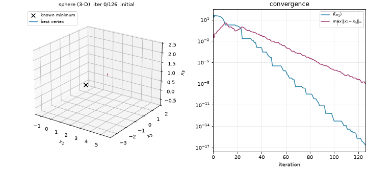

# nelder-mead

The Nelder-Mead downhill simplex method in any dimension, following the formulation of Lagarias et al. (1998), with:

- bundled benchmark functions;
- one CSV history row per iteration;
- animations of the simplex: triangles over contours in 2-D, tetrahedra in 3-D.

With the same initial simplex and tolerances it performs exactly the same steps as `scipy.optimize.minimize(method="Nelder-Mead")`. The tests check this.

<p>
  
  
</p>

## Run

From the repository root, after `uv sync`:

```bash
uv run nelder-mead --function rosenbrock --dim 2 --animate   # output/rosenbrock-2d.csv + .gif
uv run nelder-mead --function sphere --dim 6 --compare-scipy # sphere, shifted-sphere, rosenbrock: any n >= 2
uv run nelder-mead --function himmelblau --show              # interactive window (booth, himmelblau: 2-D)
uv run nelder-mead --all --animate --output-dir nelder-mead/results --gif-dir docs/img
uv run nelder-mead --help
```

```python
from nelder_mead import get_problem, minimize

problem = get_problem("rosenbrock", 2)
result = minimize(problem.function.func, initial_simplex=problem.initial_simplex)
result.x, result.fun, result.nit, result.nfev  # plus result.simplices, result.steps
```

## Layout

- `src/nelder_mead/`
  - `optimizer.py`: `minimize`, `Coefficients`, `Result`, `Step`, `default_simplex`, `simplex_volume`.
  - `functions.py`: the benchmarks, their known minimizers and the bundled demo problems.
  - `visualize.py`: GIF output (Pillow) or MP4 output (ffmpeg).
  - `cli.py`: the `nelder-mead` command.
- `results/`: CSV histories of the bundled demos.
- `tests/`: convergence, SciPy parity, simplex invariants and the CLI.

The coefficients, termination rules and results table are in the [root README](../README.md).

Coursework for the Optimization course at UERJ (Instituto Politécnico), taught by Prof. [Gustavo Libotte](https://github.com/gustavolibotte).
