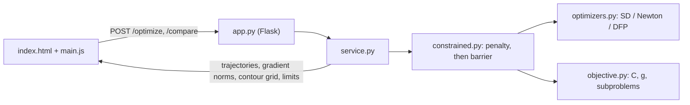

# tank-optimizer

Minimum-cost design of a closed cylindrical steel tank, solved with three gradient-based
line-search methods (Steepest Descent, Newton, DFP quasi-Newton) and an interior-barrier /
exterior-penalty formulation of the constraints. A Flask + Plotly UI shows the cost contours,
the feasible region, each method's trajectory and its gradient-norm convergence.

## Problem

Decision variables: inner diameter $D$ and length $L$ (m). Data: required volume
$V_0 = 0.8\ \text{m}^3$ (±10 %), plate thickness $t = 0.03$ m, steel density
$\rho = 8000\ \text{kg/m}^3$, material cost $c_m = 4.5$ \$/kg, weld cost $c_w = 20$ \$/m,
$D_{\max} = 1$ m, $L_{\max} = 2$ m.

$$
\min_{D,\,L}\; C(D, L) = c_m\,\rho\left[\pi L\left(\left(\tfrac{D}{2}+t\right)^2-\left(\tfrac{D}{2}\right)^2\right) + 2\pi\left(\tfrac{D}{2}+t\right)^2 t\right] + c_w\,4\pi\,(D + t)
$$

$$
\text{s.t.}\quad 0.9\,V_0 \le \frac{\pi D^2 L}{4} \le 1.1\,V_0,\qquad L \le L_{\max},\qquad D \le D_{\max}.
$$

The first bracket is the steel volume of the shell plus the two flat end plates; the weld term
is two circumferential seams per end plate at the mean diameter $D + t$.

The constrained problem is solved as a sequence of unconstrained minimizations (SUMT,
`constrained.py`), each warm-started from the previous solution:

1. **Exterior penalty**, used only while the design is infeasible:
   $\psi_r(x) = C(x) + r \sum_i \max\left(0,\ g_i(x) + \delta\right)^2$ with
   $r = 10^5, 10^6, \dots$ and an inward margin $\delta = 10^{-3}$. It stops as soon as the
   iterate is strictly feasible.
2. **Interior log barrier**: $\phi_\mu(x) = C(x) - \mu \sum_i \ln\left(-g_i(x)\right)$ with
   $\mu = 10, 1, 0.1, 0.01$. The final design is feasible by construction and within
   $O(\mu)$ of the optimal cost.

Gradients and Hessians of $C$, $g$, $\psi_r$ and $\phi_\mu$ are exact (closed form), and the
tests check them against finite differences.

## Methods

All three methods share one loop (`optimizers.BaseOptimizer`). Each iteration picks a search
direction $p_k$, falls back to $-\nabla\phi$ when $p_k$ is not a descent direction, and takes
an Armijo backtracking step ($c_1 = 10^{-4}$, factor $0.5$). The loop stops when
$\lVert\nabla\phi\rVert \le \varepsilon$, which only the last barrier subproblem must meet
(earlier ones use $10^{-2}$). `optimizers.Objective` counts function, gradient and Hessian
evaluations, and falls back to central finite differences when exact derivatives are not
supplied.

| Method | Direction |
| --- | --- |
| Steepest Descent | $p_k = -\nabla\phi_k$ |
| Newton | $p_k = -H_k^{-1}\nabla\phi_k$ |
| DFP | $p_k = -B_k\nabla\phi_k$, $B_{k+1} = B_k + \frac{ss^\top}{s^\top y} - \frac{B_k y y^\top B_k}{y^\top B_k y}$ (only when $s^\top y > 0$) |

## Run

```bash
uv run tank-optimizer                 # web UI on http://127.0.0.1:5000
uv run tank-optimizer compare --d0 0.5 --l0 0.5   # same comparison in the terminal
```

## Results

Reference optimum: the cost increases with both D and L, so the lower volume bound is active,
and minimizing along $\pi D^2 L / 4 = 0.72$ gives $D^* = 0.948760$ m, $L^* = 1.018428$ m,
$C^* = 5354.35$ \$.

From $(D_0, L_0) = (0.5, 0.5)$ (infeasible, $V = 0.098\ \text{m}^3$), with `tol = 1e-6` and `max_iter = 200`
(`uv run tank-optimizer compare`):

| Method | D* [m] | L* [m] | V [m³] | Cost [\$] | Iterations | f evals | Status |
| --- | ---: | ---: | ---: | ---: | ---: | ---: | --- |
| Steepest Descent | 0.9837 | 0.9474 | 0.7200 | 5,361.21 | 200 | 4,810 | feasible, budget spent |
| Newton | 0.9487 | 1.0185 | 0.7200 | 5,354.36 | 45 | 146 | converged |
| DFP | 0.9487 | 1.0185 | 0.7200 | 5,354.36 | 96 | 337 | converged |

Across eight starting points (the default plus the seven distinct UI presets), Newton converges every time
(44 to 64 iterations). DFP always ends \$0.01 from $C^*$ (the offset left by the final barrier
weight) but meets the gradient tolerance from only one start. Steepest Descent always ends
feasible, 1.3 to 336 \$ above $C^*$: the barrier subproblems are too ill-conditioned for it.

## Layout

```
src/tank_optimizer/
├── objective.py    # cost model, constraints g(x) <= 0, penalty/barrier subproblems + derivatives
├── constrained.py  # SUMT driver: exterior penalty phase, then decreasing barrier weights
├── optimizers.py   # SD, Newton, DFP; Armijo line search; evaluation counting
├── service.py      # request validation, runs the methods, builds the JSON payload
├── app.py          # Flask app factory: GET /, POST /optimize, POST /compare
├── cli.py          # `tank-optimizer serve | compare`
├── templates/index.html   # UI (Tailwind + Plotly from CDNs)
└── static/js/main.js      # API calls, plots, animated trajectories
```



The UI has a single-method tab (results, contour + trajectory, gradient convergence) and a
comparison tab (all three methods from the same start, animated, with a results table), plus
eight preset scenarios (starts far from the optimum, near the boundary, violating
$V_{\min}$/$V_{\max}$, etc.).

## Changes from the original coursework version

The original version minimized one surrogate: the cost plus a log barrier
($\mu = 10^{-3}$) inside the feasible set, and the cost plus a quadratic penalty plus a
constant $10^{12}$ outside it, all with finite-difference derivatives. This had three
problems:

* At $f \approx 10^{12}$, the spacing between adjacent floats ($\approx 10^{-4}$) is larger than
  the change a $10^{-8}$ step produces. Central differences therefore returned a gradient of
  exactly zero, and the methods "converged" at infeasible designs. From $(0.5, 0.5)$,
  Steepest Descent stopped at $D = 1.002 > D_{\max}$ with $V = 0.717$, and Newton at
  $V = 0.718$. From $(0.98, 0.95)$, SD reported 5,340.94 \$, below the true optimum,
  for a tank that is too small.
* The gradient of the penalty branch ignores the constant, so the surrogate has a spurious
  stationary point outside the feasible set ($V \approx 0.7176$). Once the derivatives are
  exact, Newton converges to it.
* DFP updated $B$ whenever $|s^\top y| > 10^{-10}$, even when $s^\top y < 0$, so $B$ could lose
  positive definiteness. Fed with the $10^{20}$-sized finite-difference gradients produced at
  the boundary, it diverged from 3 of the 8 starts above ($D \approx 5 \times 10^9$, NaN
  gradient norm).

The penalty-then-barrier sequence with exact derivatives fixes all three. The line search no
longer re-evaluates $f(x)$ and the gradient at every backtracking step. The UI's replay
animations no longer cancel each other, and the UI is now in English.
